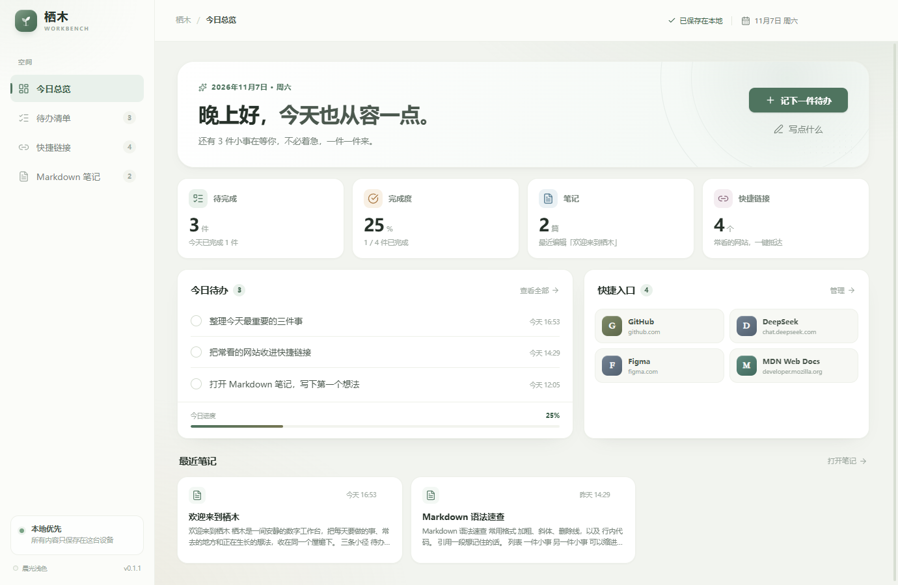
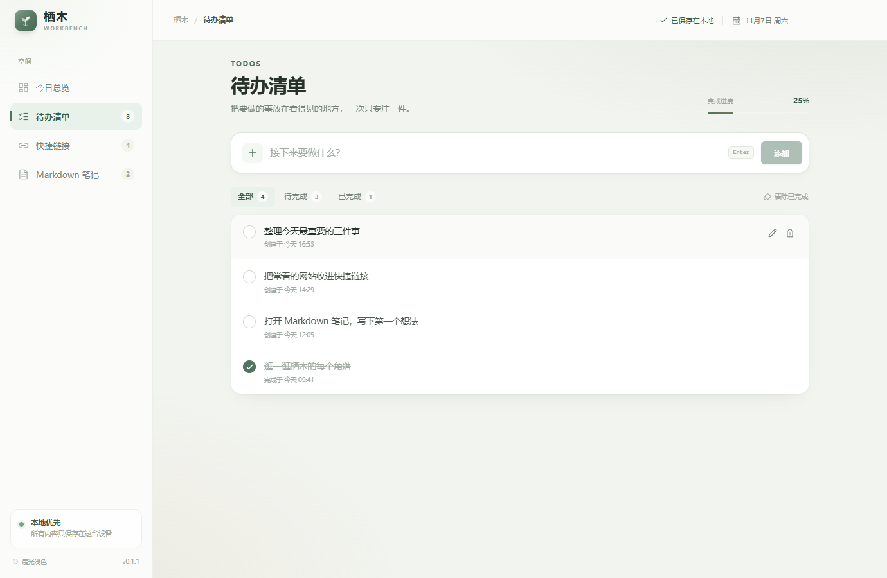
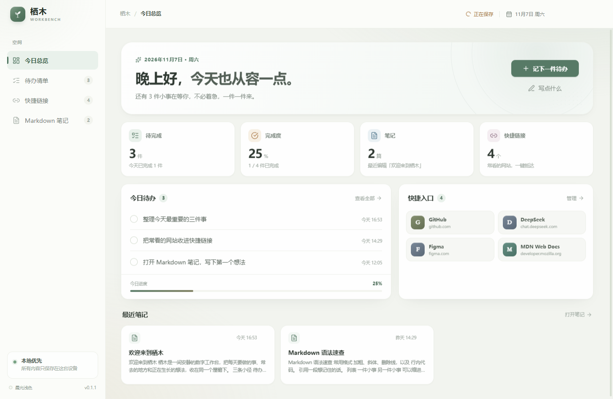
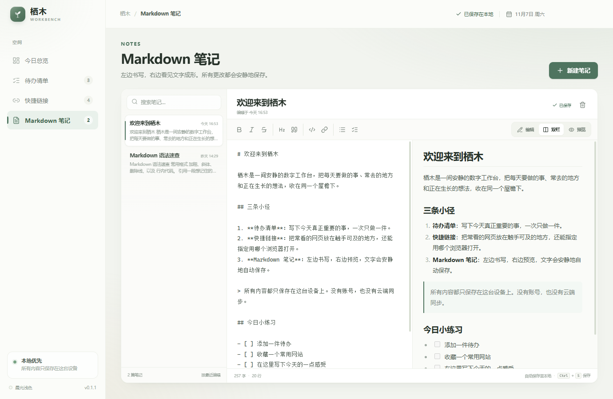

# 栖木工作台

一个安静、本地优先的桌面效率空间。使用 **Electron + React + TypeScript** 构建，把待办、常用网页和 Markdown 笔记收进同一个工作台。



## 功能

- **今日总览**：集中查看完成进度、待办、快捷入口与最近笔记。
- **待办清单**：快速添加、点击完成、内联编辑、筛选、删除与清除已完成。
- **快捷链接**：收藏常去网页，点击即用浏览器打开；可针对每个链接指定使用已安装的 Chrome、Edge、Firefox、Brave、Vivaldi 或 Opera，也可以交给系统默认浏览器。
- **Markdown 笔记**：编辑 / 双栏 / 预览三种视图，格式工具栏，搜索、自动保存、字数统计，支持表格、任务列表、代码块等常用语法。
- **本地优先**：无需账号，所有数据以 JSON 形式保存在本机；关闭窗口时还会做一次同步落盘。
- **浅色主题**：所有颜色经由语义化 CSS 变量提供，功能组件与主题样式解耦。

| 待办清单 | 快捷链接 |
| --- | --- |
|  |  |



## 快速开始

环境要求：Node.js >= 22.12，pnpm 12（项目锁定 `pnpm@12.4.2`）。

```bash
pnpm install
pnpm dev
```

常用命令：

| 命令 | 说明 |
| --- | --- |
| `pnpm dev` | 启动 Vite 开发服务器与 Electron，支持渲染层热更新 |
| `pnpm typecheck` | 分别检查主进程与渲染层 TypeScript |
| `pnpm build` | 类型检查并生成生产构建到 `out/` |
| `pnpm start` | 用 Electron 预览生产构建（仍使用开发数据目录） |
| `pnpm package:win` | 生成 Windows NSIS 安装包到 `release/` |

> Electron 的运行时二进制默认从 GitHub 下载。仓库内的 `.npmrc` 已配置 npmmirror 镜像以加快安装；如需换回官方源，删除其中 `electron_mirror` 一行即可。打包配置使用本机 `node_modules/electron/dist`，因此无需再次下载 Electron。

打包完成后：

- 安装包：`release/栖木工作台 Setup 0.1.1.exe`
- 免安装运行：`release/win-unpacked/栖木工作台.exe`

当前安装包未进行代码签名。在本机自用没有问题；正式对外分发时建议配置 Windows 代码签名证书，以减少 SmartScreen 提示。

首次打开会自动放入一组可自由修改或删除的示例待办、快捷链接与两篇说明笔记。

## 数据与安全

### 开发 / 生产数据隔离

两个环境使用各自独立的目录、Chromium 会话与单实例锁，可以同时运行而互不影响：

| 环境 | 数据目录 |
| --- | --- |
| 生产环境（安装包 / `win-unpacked`） | `~/.qimu-workbench` |
| 开发环境（`pnpm dev` / `pnpm start`） | `~/.qimu-workbench-dev` |

业务数据文件为各自目录下的 `workspace.json`。Windows 上 `~` 即 `%USERPROFILE%`；环境由 Electron 的 `app.isPackaged` 判定。

- 保存策略：渲染层修改后约 380ms 防抖写入；页面关闭时通过同步 IPC 补写，避免最后几个字符丢失；写入采用临时文件替换。
- 进程隔离：渲染层不开启 Node.js，启用 `contextIsolation` 与沙箱，只通过 preload 暴露最小 API。
- 链接保护：只接受 `http://` / `https://` 地址；浏览器打开目标只能来自主进程探测到的可执行文件，渲染层无法传入任意命令路径；Markdown 预览经 DOMPurify 清洗，外部链接交给系统打开。
- 浏览器探测：优先检查各平台常见安装路径，Windows 下再通过注册表 `App Paths` 兜底，结果在本次运行内缓存。

## 目录结构

```text
src/
├─ shared/                 纯类型与共享契约（无 Electron 依赖）
│  ├─ types.ts             Todo / QuickLink / MarkdownNote / BrowserInfo
│  ├─ api.ts               preload API 与 IPC channel 契约
│  └─ defaults.ts          首次启动内容
├─ main/                   主进程
│  ├─ index.ts             窗口、安全策略、IPC 注册
│  ├─ data-paths.ts        开发/生产数据目录
│  ├─ store.ts             本地 JSON 读取、校验、原子写入
│  └─ browsers.ts          已安装浏览器探测与指定浏览器打开
├─ preload/                类型化 contextBridge
└─ renderer/src/
   ├─ app/                 应用壳、侧边栏、顶栏、WorkspaceProvider
   ├─ features/            业务模块，彼此独立
   │  ├─ overview/
   │  ├─ todos/
   │  ├─ links/
   │  └─ notes/
   ├─ components/
   │  ├─ ui/               Button、Modal、Toast、Segmented、EmptyState 等
   │  └─ layout/           PageHeader、BrandMark
   ├─ services/desktop.ts  渲染层唯一与 Electron 通信的入口
   ├─ hooks/               可复用 React hooks
   ├─ lib/                 格式化、URL、Markdown 等纯函数
   ├─ theme/               ThemeProvider 与主题注册表
   └─ styles/
      ├─ tokens.css        字体、间距、圆角、动效等非颜色 token
      ├─ tones.css         快捷链接品牌色
      ├─ base.css          全局重置
      └─ themes/light.css  当前浅色主题的语义颜色 token
```

### 分层原则

1. **业务与 UI 分离**：业务组件只消费 `useWorkspace()` 提供的状态与 action；通用交互放在 `components/ui`，页面骨架放在 `components/layout`。
2. **功能模块独立**：每个 feature 拥有自己的视图、局部组件与样式；总览只通过统一的 action 和导航回调触达其他模块。
3. **桌面能力隔离**：feature 不直接访问 `window.workbench`，统一经过 `services/desktop.ts`。以后做 Web / 移动端时，可直接替换这一层实现。
4. **主题与组件解耦**：组件样式只引用语义变量（如 `--color-surface`、`--color-accent`），不直接写浅色值。

### 添加新主题

1. 复制 `src/renderer/src/styles/themes/light.css` 为新主题文件，覆盖同名语义变量。
2. 在 `main.tsx` 引入新主题样式。
3. 在 `theme/ThemeProvider.tsx` 的 `THEMES` 注册表中增加主题项。

现有组件无需改动。若新增功能需要新的颜色，同样在主题文件中补充语义 token，而不是在组件 CSS 中写死颜色。

## 当前范围

当前针对桌面端实现，并在 Windows 上验证。主进程已包含 macOS / Linux 的常见浏览器路径，但窗口控制样式目前以 Windows 的无边框标题栏为默认目标；未来扩展移动或 Web 端时，渲染层业务模块可以复用，Electron 相关的 `main/`、`preload/` 与 `services/desktop.ts` 需要替换为对应平台的实现。
